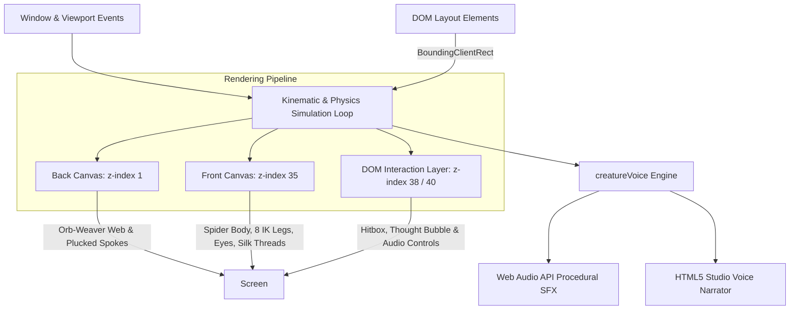
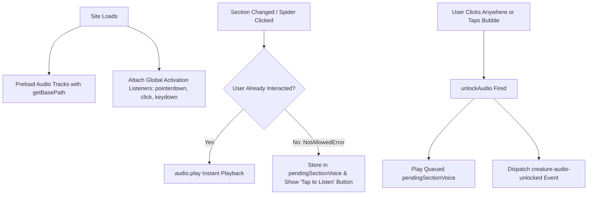
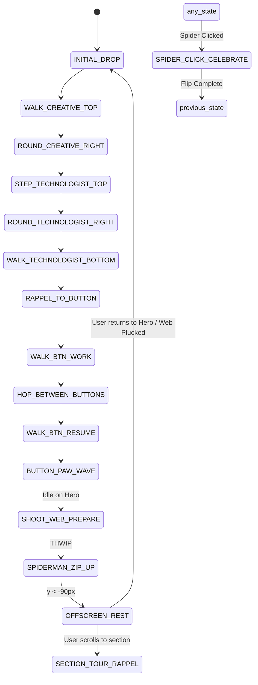

# 🕷️ Zephyr: The Cute Spatial Spider Companion
### Complete Architectural Blueprint, Physics Engine & Implementation Guide

> **Author**: Gaurav Roy & DeepMind Antigravity Pair-Programming Suite  
> **Target Platforms**: Next.js (App Router / Pages Router), React (Vite / CRA), Astro, Remix, Vanilla HTML5 Canvas  
> **License**: MIT / Creative Technologist Commercial Use  

---

## 📑 Table of Contents
1. [Why Use a Spatial Companion Mascot?](#1-why-use-a-spatial-companion-mascot)
2. [High-Level Architecture](#2-high-level-architecture)
3. [Core Systems & Mathematical Foundations](#3-core-systems--mathematical-foundations)
   - [A. Two-Layer Canvas Compositing](#a-two-layer-canvas-compositing)
   - [B. Authentic Corner Web & String Pluck Physics](#b-authentic-corner-web--string-pluck-physics)
   - [C. Biomechanical Anatomy & Tetrapod Leg Gait](#c-biomechanical-anatomy--tetrapod-leg-gait)
   - [D. Typography Contour Navigation (Border Hugging)](#d-typography-contour-navigation-border-hugging)
   - [E. Physical Pendulum Simulation & Wind Sway](#e-physical-pendulum-simulation--wind-sway)
   - [F. Acrobatic 360° Backflip & Romance System](#f-acrobatic-360-backflip--romance-system)
   - [G. Spider-Man Elastic Zip Exit & Cooldown](#g-spider-man-elastic-zip-exit--cooldown)
4. [Voice & Audio Engine Architecture](#4-voice--audio-engine-architecture)
5. [State Machine Lifecycle](#5-state-machine-lifecycle)
6. [Step-by-Step Implementation Guide](#6-step-by-step-implementation-guide)
   - [Step 1: Install Dependencies](#step-1-install-dependencies)
   - [Step 2: Audio Engine Setup (`creatureVoice.ts`)](#step-2-audio-engine-setup-creaturevoicets)
   - [Step 3: Companion Component Setup (`CuteSpiderCompanion.tsx`)](#step-3-companion-component-setup-cutespidercompaniontsx)
   - [Step 4: Layout & DOM Element Anchoring](#step-4-layout--dom-element-anchoring)
7. [Customization & Tuning Matrix](#7-customization--tuning-matrix)
8. [Performance & Mobile Optimization](#8-performance--mobile-optimization)
9. [Troubleshooting & Common Pitfalls](#9-troubleshooting--common-pitfalls)

---

## 1. Why Use a Spatial Companion Mascot?

Most modern creative portfolios and technology landing pages suffer from **"Static Brochure Syndrome"** — flat grids, predictable typography, and no emotional resonance. 

The **Cute Spider Companion ("Zephyr")** solves this through **Spatial Embodiment**:
* **High Memory Retention**: Visitors remember a living, reactive mascot far longer than another grid of mockups.
* **Non-Intrusive Guidance**: Rather than pop-up modals or chat widgets, Zephyr perches atop headers, rappels down alongside sections, and offers bite-sized commentary.
* **Tactile Playfulness**: Users can pluck the corner web strings like an instrument, click the spider to watch it backflip with heart eyes, or have it point out key CTAs.
* **Seamless Contextual Narrative**: As visitors explore the site, Zephyr acts as an interactive docent, speaking in a studio-recorded companion voice tailored to each section.
* **Polite Autonomy**: If the visitor lingers to read content, Zephyr shoots an elastic silk thread and zips offscreen so it never blocks reading flow.

---

## 2. High-Level Architecture

The companion system is composed of three decoupled architectural layers:



### Layer Separation
1. **Back Canvas (`z-index: 1`)**: Renders behind all portfolio content. Draws the authentic orb-weaver corner web, anchor foundation lines, and catenary web spirals.
2. **Portfolio UI (`z-index: 10 - 30`)**: Your standard HTML typography, portfolio cards, and interactive buttons.
3. **Front Canvas (`z-index: 35`)**: Renders directly above typography. Draws the spider cephalothorax, abdomen, 8 animated legs, eyes, silk thread, and particles.
4. **DOM Overlay (`z-index: 38 / 40`)**: An invisible circular hitbox tracking the spider for 100% reliable click detection, plus a glassmorphic thought bubble displaying typewriter commentary.

---

## 3. Core Systems & Mathematical Foundations

### A. Two-Layer Canvas Compositing
To prevent the web from obscuring readability while keeping the spider crisp and tactile over headlines:
```typescript
<canvas ref={canvasBackRef} className="fixed inset-0 pointer-events-none z-[1]" />
<canvas ref={canvasFrontRef} className="fixed inset-0 pointer-events-none z-[35]" />
```
Both canvases dynamically resize to `window.innerWidth` and `window.innerHeight` with retina DPI scaling (`window.devicePixelRatio`).

---

### B. Authentic Corner Web & String Pluck Physics
The corner web is an authentic orb-weaver spiral anchored to the top-left corner `(0, 0)`.

#### 1. Radial Spokes
8 radial foundation spokes radiate outward at computed angles $\theta_i \in [5^\circ, 85^\circ]$ up to a radius strictly constrained by the letter 'C' in the hero title:
$$\text{spoke}_i = (R \cdot \cos\theta_i, \; R \cdot \sin\theta_i)$$

#### 2. Catenary Sag Spiral Arcs
Between each spoke pair $(i, i+1)$ across 5 concentric rings, web spirals are rendered using quadratic Bézier curves with a natural gravitational/surface-tension sag factor:
$$\mathbf{P}_{\text{control}} = \frac{\mathbf{P}_i + \mathbf{P}_{i+1}}{2} + \hat{\mathbf{v}}_{\text{sag}} \cdot \text{sagFactor}$$

#### 3. String Pluck Harmonic Oscillator
When the mouse crosses a spoke within the web radius, a pluck velocity is imparted. The spoke vibrates as a damped harmonic oscillator:
$$\frac{d^2 x}{dt^2} + 2\zeta\omega_0 \frac{dx}{dt} + \omega_0^2 x = 0$$
Where:
* $\text{pluckOffset} \leftarrow \text{pluckOffset} + \text{pluckVelocity} \cdot dt$
* $\text{pluckVelocity} \leftarrow (\text{pluckVelocity} - \text{pluckOffset} \cdot k) \cdot \text{damping}$
* Spring constant $k \approx 0.18$, Damping $\approx 0.86$.

Each pluck triggers a synthesized Web Audio sine pluck sound with frequency mapped to spoke length:
$$f = 520\text{Hz} + |\Delta_{\text{offset}}| \cdot 80\text{Hz}$$

---

### C. Biomechanical Anatomy & Tetrapod Leg Gait
Zephyr is constructed purely via code using parametric 2D vector primitives—no heavy 3D GLB models or external sprite sheets required!

#### 1. Anatomy Structure
* **Abdomen**: Elliptical sphere ($12.5\text{px} \times 10.5\text{px}$) with soft purple radial gradient, chitin rim highlight, and 3 subtle pastel spots.
* **Cephalothorax (Head)**: Overlapping circle ($8.2\text{px}$ radius) with drop shadow and glossy forehead sheen.
* **Expressive Eyes**: Two primary forward-facing obsidian eyes ($2.8\text{px}$ radius) with dual specular light reflections and look-at pupil tracking towards the cursor.

#### 2. Alternating Tetrapod Gait
The 8 legs are divided into two synchronized groups:
* **Group A**: Left 1, Left 3, Right 2, Right 4
* **Group B**: Left 2, Left 4, Right 1, Right 3

During locomotion, gait phase $\phi \in [0, 2\pi)$ alternates: Group A lifts and swings forward while Group B anchors and pushes backward, producing an authentic, fluid arachnid scuttle:
$$y_{\text{swing}}(\phi) = -h_{\text{step}} \cdot \sin(\phi)$$

Leg joints flex through 3 parametric segments:
1. **Coxa Base**: Attached to lateral margin of cephalothorax.
2. **Femur Knee**: Reaches upward and outward.
3. **Tibia / Tarsus**: Descends to touch the walking surface.

---

### D. Typography Contour Navigation (Border Hugging)
Instead of wandering randomly in negative space, Zephyr hugs the precise geometry of headline text elements (`hero-word-creative`, `hero-word-technologist`, and CTA buttons).

```
(0,0) Anchor
  |
  |  (INITIAL_DROP)
  v
[ C R E A T I V E ] ────> (WALK_CREATIVE_TOP)
                │
                v  (ROUND_CREATIVE_RIGHT)
[ T E C H N O L O G I S T ] <─── (STEP_TECHNOLOGIST_TOP)
│
v  (RAPPEL_TO_BUTTON)
[ VIEW WORK ] ──(HOP)──> [ RESUME ]
```

#### Traversal Sequence:
1. **`INITIAL_DROP`**: Descends from the ceiling anchor $(x, 0)$ directly onto the left flank of the word "CREATIVE".
2. **`WALK_CREATIVE_TOP`**: Skirts horizontally across the top boundary of the word with legs actively stepping.
3. **`ROUND_CREATIVE_RIGHT`**: Interpolates spider heading angle $\theta$ around the right curve of the letter 'E'.
4. **`STEP_TECHNOLOGIST_TOP`**: Bridges the gap and traverses the second line.
5. **`RAPPEL_TO_BUTTON`**: Spins a downward silk thread and lands directly on the "VIEW MY WORK" button.
6. **`WALK_BTN_WORK` & `HOP_BETWEEN_BUTTONS`**: Performs a light hop between the primary and secondary CTA buttons.
7. **`BUTTON_PAW_WAVE`**: Rears up on hind legs and waves front paws encouraging visitors to click.

---

### E. Physical Pendulum Simulation & Wind Sway
When visiting content sections outside the hero, Zephyr anchors to the ceiling and rappels down on a silk thread as an authentic damped pendulum:

$$\ddot{\theta} = -\frac{g}{L} \sin(\theta) - b \cdot \dot{\theta} + F_{\text{wind}}$$

```typescript
// Semi-implicit Euler integration
const gravityTerm = (-0.00042 * Math.sin(pendulumAngle)) / Math.max(0.5, pendulumLength / 200);
pendulumAngularVel += (gravityTerm + windImpulse) * dt;
pendulumAngularVel *= Math.pow(0.988, dt); // High air resistance damping
pendulumAngle += pendulumAngularVel * dt;
```

* **Interactive Breeze**: Mouse cursor movements $(\Delta x)$ generate virtual wind drag, causing the hanging companion to swing gently as the visitor moves their pointer.

---

### F. Acrobatic 360° Backflip & Romance System
Clicking Zephyr triggers an instant, joyous celebratory backflip:
1. **Parabolic Leap**: Spider leaps upward ($y_{\text{leap}} = -48\text{px} \cdot \sin(\pi \cdot p)$).
2. **Full Rotational Flip**: $360^\circ$ pitch rotation ($p \cdot 2\pi$).
3. **Heart Eyes Mode**: Eyes morph into glowing pulsing pink silk hearts.
4. **Silk Heart Particles**: Emits floating ascending silk hearts with sine-wave horizontal drift.
5. **Pastel Confetti**: Triggers `canvas-confetti` explosion with curated pastel luxury colors:
   ```typescript
   confetti({
     particleCount: 28,
     spread: 70,
     origin: { x: spiderX / width, y: spiderY / height },
     colors: ['#E879F9', '#C084FC', '#38BDF8', '#F472B6', '#FFFFFF'],
   });
   ```
6. **Audio Feedback**: Synthesizes a radiant major chord chime ($E_5, G^\#_5, B_5, E_6$) and plays Zephyr's affectionate voice clip:
   > *"Hehe! You found me! Sending you lots of love! ♡"*

---

### G. Spider-Man Elastic Zip Exit & Cooldown
To respect reading flow, Zephyr does not stay permanently in front of reading material:
1. **Dwell Detection**: If the visitor stops on a content section for $> 20$ seconds without interacting, Zephyr prepares an exit.
2. **Web Shoot ("THWIP")**: Shoots an upward web thread straight to the ceiling ($y = 0$). Synthesizes high-frequency triangle wave sweep ($220\text{Hz} \to 1400\text{Hz}$).
3. **Elastic Zip Launch**: Launches upward with exponential velocity ($v_{\text{zip}} = -34\text{px/frame}$), exiting offscreen ($y < -90\text{px}$). Synthesizes twang + whoosh sound effect.
4. **Offscreen Cooldown**: Rests quietly offscreen. Wakes up smoothly whenever the visitor scrolls back to the top or interacts with the corner web.

---

## 4. Voice & Audio Engine Architecture

Zephyr's voice engine ([`creatureVoice.ts`](file:///g:/potrait/Gaurav%27s%20Website/src/utils/creatureVoice.ts)) solves three critical web audio challenges:
1. **Browser Autoplay Restrictions**: Browsers block audio before user interaction.
2. **Hosting Subpaths (GitHub Pages vs. Custom Domain)**: Relative path 404s.
3. **Latency**: Audio clips must play with zero delay.



### Dynamic Path Resolver
Ensures audio paths work seamlessly across GitHub Pages (`/repo-name/audio/...`), custom domains (`/audio/...`), and localhost:
```typescript
export const getBasePath = (): string => {
  if (typeof process !== 'undefined' && process.env.NEXT_PUBLIC_BASE_PATH) {
    return process.env.NEXT_PUBLIC_BASE_PATH;
  }
  if (typeof window !== 'undefined') {
    const pathname = window.location.pathname;
    if (pathname.startsWith('/gaurav-roy-portfolio')) return '/gaurav-roy-portfolio';
    if (window.location.hostname.endsWith('github.io')) {
      const parts = pathname.split('/').filter(Boolean);
      if (parts.length > 0) return `/${parts[0]}`;
    }
  }
  return '';
};
```

---

## 5. State Machine Lifecycle



---

## 6. Step-by-Step Implementation Guide

Follow these steps to implement Zephyr into any Next.js, React, or Vite project:

### Step 1: Install Dependencies
```bash
npm install lucide-react canvas-confetti clsx tailwind-merge
npm install -D @types/canvas-confetti
```

---

### Step 2: Audio Engine Setup (`creatureVoice.ts`)
Create `src/utils/creatureVoice.ts`:

```typescript
// creatureVoice.ts - Lightweight Audio Engine with Procedural SFX & Voice Narration
let audioCtx: AudioContext | null = null;
let soundEnabled = true;
let pendingSectionVoice: string | null = null;
let autoplayUnlocked = false;

export const getBasePath = (): string => {
  if (typeof process !== 'undefined' && process.env.NEXT_PUBLIC_BASE_PATH) {
    return process.env.NEXT_PUBLIC_BASE_PATH;
  }
  if (typeof window !== 'undefined' && window.location.hostname.endsWith('github.io')) {
    const parts = window.location.pathname.split('/').filter(Boolean);
    if (parts.length > 0) return `/${parts[0]}`;
  }
  return '';
};

export const getAudioSrc = (trackKey: string): string => {
  return `${getBasePath()}/audio/spider/${trackKey}.wav`;
};

const audioInstances: Record<string, HTMLAudioElement> = {};
let currentlyPlaying: HTMLAudioElement | null = null;

export const getAudioInstance = (key: string): HTMLAudioElement | null => {
  if (typeof window === 'undefined') return null;
  const targetSrc = getAudioSrc(key);
  let audio = audioInstances[key];
  if (!audio) {
    audio = new Audio(targetSrc);
    audio.preload = 'auto';
    audio.volume = 0.95;
    audioInstances[key] = audio;
  } else if (!audio.src || !audio.src.includes(targetSrc)) {
    audio.src = targetSrc;
  }
  return audio;
};

const getAudioContext = (): AudioContext | null => {
  if (typeof window === 'undefined') return null;
  if (!audioCtx) {
    const AudioContextClass = window.AudioContext || (window as any).webkitAudioContext;
    if (AudioContextClass) audioCtx = new AudioContextClass();
  }
  if (audioCtx && audioCtx.state === 'suspended') {
    audioCtx.resume().catch(() => {});
  }
  return audioCtx;
};

export const unlockAudio = () => {
  autoplayUnlocked = true;
  if (typeof window !== 'undefined') {
    window.dispatchEvent(new CustomEvent('creature-audio-unlocked'));
  }
  const ctx = getAudioContext();
  if (ctx && ctx.state === 'suspended') ctx.resume().catch(() => {});
  if (pendingSectionVoice && soundEnabled) {
    const key = pendingSectionVoice;
    pendingSectionVoice = null;
    playSectionVoice(key);
  }
};

if (typeof window !== 'undefined') {
  ['pointerdown', 'click', 'keydown', 'touchstart'].forEach((evt) => {
    window.addEventListener(evt, unlockAudio, { capture: true, passive: true });
  });
}

export const playSectionVoice = (sectionKey: string): HTMLAudioElement | null => {
  if (!soundEnabled || typeof window === 'undefined') return null;
  stopAllSpiderVoices();
  const audio = getAudioInstance(sectionKey);
  if (!audio) return null;

  try {
    audio.currentTime = 0;
    audio.volume = 0.95;
    currentlyPlaying = audio;
    audio.play().then(() => {
      autoplayUnlocked = true;
      pendingSectionVoice = null;
    }).catch((err) => {
      if (err?.name === 'NotAllowedError') pendingSectionVoice = sectionKey;
    });
  } catch (_) {
    pendingSectionVoice = sectionKey;
  }
  return audio;
};

export const playSpiderCelebrateVoice = () => playSectionVoice('celebrate');

export const stopAllSpiderVoices = () => {
  if (currentlyPlaying) {
    currentlyPlaying.pause();
    currentlyPlaying.currentTime = 0;
    currentlyPlaying = null;
  }
};

// Procedural String Pluck Sound Effect
export const playWebPluckSound = (velocity: number = 1.0) => {
  if (!soundEnabled) return;
  const ctx = getAudioContext();
  if (!ctx) return;
  try {
    const now = ctx.currentTime;
    const osc = ctx.createOscillator();
    const gain = ctx.createGain();
    const freq = 520 + Math.abs(velocity) * 80;
    osc.type = 'sine';
    osc.frequency.setValueAtTime(freq, now);
    osc.frequency.exponentialRampToValueAtTime(freq * 0.7, now + 0.08);
    gain.gain.setValueAtTime(0.001, now);
    gain.gain.linearRampToValueAtTime(0.04, now + 0.004);
    gain.gain.exponentialRampToValueAtTime(0.0001, now + 0.075);
    osc.connect(gain);
    gain.connect(ctx.destination);
    osc.start(now);
    osc.stop(now + 0.08);
  } catch (_) {}
};

// Procedural Major Chord Joyful Chime
export const playJoyfulChime = () => {
  if (!soundEnabled) return;
  const ctx = getAudioContext();
  if (!ctx) return;
  try {
    [659.25, 830.61, 987.77, 1318.51].forEach((freq, idx) => {
      const now = ctx.currentTime + idx * 0.045;
      const osc = ctx.createOscillator();
      const gain = ctx.createGain();
      osc.type = 'sine';
      osc.frequency.setValueAtTime(freq, now);
      gain.gain.setValueAtTime(0.001, now);
      gain.gain.linearRampToValueAtTime(0.045, now + 0.006);
      gain.gain.exponentialRampToValueAtTime(0.0001, now + 0.22);
      osc.connect(gain);
      gain.connect(ctx.destination);
      osc.start(now);
      osc.stop(now + 0.24);
    });
  } catch (_) {}
};

// Procedural Web Shoot 'THWIP' SFX
export const playWebShootSound = () => {
  if (!soundEnabled) return;
  const ctx = getAudioContext();
  if (!ctx) return;
  try {
    const now = ctx.currentTime;
    const osc = ctx.createOscillator();
    const gain = ctx.createGain();
    osc.type = 'triangle';
    osc.frequency.setValueAtTime(220, now);
    osc.frequency.exponentialRampToValueAtTime(1400, now + 0.06);
    gain.gain.setValueAtTime(0.07, now);
    gain.gain.exponentialRampToValueAtTime(0.001, now + 0.08);
    osc.connect(gain);
    gain.connect(ctx.destination);
    osc.start(now);
    osc.stop(now + 0.09);
  } catch (_) {}
};

// Procedural Spiderman Elastic Zip SFX
export const playElasticZipSound = () => {
  if (!soundEnabled) return;
  const ctx = getAudioContext();
  if (!ctx) return;
  try {
    const now = ctx.currentTime;
    // Elastic Snap
    const oscSnap = ctx.createOscillator();
    const gainSnap = ctx.createGain();
    oscSnap.type = 'sawtooth';
    oscSnap.frequency.setValueAtTime(820, now);
    oscSnap.frequency.exponentialRampToValueAtTime(140, now + 0.09);
    gainSnap.gain.setValueAtTime(0.001, now);
    gainSnap.gain.linearRampToValueAtTime(0.08, now + 0.005);
    gainSnap.gain.exponentialRampToValueAtTime(0.0001, now + 0.09);
    oscSnap.connect(gainSnap);
    gainSnap.connect(ctx.destination);
    oscSnap.start(now);
    oscSnap.stop(now + 0.10);

    // Upward Whoosh
    const oscZip = ctx.createOscillator();
    const gainZip = ctx.createGain();
    oscZip.type = 'sine';
    oscZip.frequency.setValueAtTime(260, now + 0.02);
    oscZip.frequency.exponentialRampToValueAtTime(2100, now + 0.16);
    gainZip.gain.setValueAtTime(0.001, now + 0.02);
    gainZip.gain.linearRampToValueAtTime(0.07, now + 0.06);
    gainZip.gain.exponentialRampToValueAtTime(0.0001, now + 0.18);
    oscZip.connect(gainZip);
    gainZip.connect(ctx.destination);
    oscZip.start(now + 0.02);
    oscZip.stop(now + 0.19);
  } catch (_) {}
};

export const isSoundEnabled = () => soundEnabled;
export const setSoundEnabled = (enabled: boolean) => {
  soundEnabled = enabled;
  if (!enabled) stopAllSpiderVoices();
};
```

---

### Step 3: Companion Component Setup (`CuteSpiderCompanion.tsx`)
Reference [`src/components/CuteSpiderCompanion.tsx`](file:///g:/potrait/Gaurav%27s%20Website/src/components/CuteSpiderCompanion.tsx) in your component tree.

Include it in your root layout:
```tsx
// src/app/layout.tsx
import { CuteSpiderCompanion } from '@/components/CuteSpiderCompanion';

export default function RootLayout({ children }: { children: React.ReactNode }) {
  return (
    <html lang="en">
      <body>
        {children}
        {/* Living Spatial Companion Mascot */}
        <CuteSpiderCompanion />
      </body>
    </html>
  );
}
```

---

### Step 4: Layout & DOM Element Anchoring
For the letter-contour navigation to anchor properly, assign these IDs to your Hero section HTML elements:
* `id="hero-word-creative"`: The primary first headline word.
* `id="hero-word-technologist"`: The secondary headline word.
* `id="hero-btn-work"`: Primary action button.
* `id="hero-btn-resume"`: Secondary action button.

For site-wide tour commentary, assign standard section IDs to your landing page sections:
* `id="hero"`, `id="companies"`, `id="specialties"`, `id="work"`, `id="capabilities"`, `id="process"`, `id="contact"`.

---

## 7. Customization & Tuning Matrix

| Parameter | Location | Default Value | Description |
| :--- | :--- | :--- | :--- |
| `currentWebRadius` | `CuteSpiderCompanion.tsx` | `205px` | Outer boundary radius of the corner web. Clamped to headline edge. |
| `SPOKE_COUNT` | `CuteSpiderCompanion.tsx` | `8` | Number of radial foundation strings radiating from top corner. |
| `spiderScale` | `CuteSpiderCompanion.tsx` | `1.0` | Global scale of the spider body and legs. |
| `pendulumLength` | `CuteSpiderCompanion.tsx` | `180px` | Length of silk thread during multi-section rappel tour. |
| `maxSpeechDuration` | `CuteSpiderCompanion.tsx` | `10.0s` | Time before thought bubble automatically dismisses. |
| `sectionDwellTimer` | `CuteSpiderCompanion.tsx` | `20.0s` | Idle seconds in content section before triggering Spiderman Zip exit. |
| `colors` | `creatureVoice.ts` | `Pastel Palette` | Colors of celebratory confetti burst on backflip. |

---

## 8. Performance & Mobile Optimization

1. **Delta-Time Normalization**:
   All kinematic movement, pendulum swinging, and walk gait equations multiply by normalized `dt = Math.min(2.5, delta * 60)`. This guarantees 100% identical walk speeds across **60Hz, 120Hz ProMotion, and 144Hz gaming monitors**.
2. **Retina Display Density**:
   Canvases automatically adjust for `devicePixelRatio` to eliminate pixelation on 4K and Apple Retina screens.
3. **Smart Viewport Culling**:
   When Zephyr is in `OFFSCREEN_REST`, the front canvas skips drawing the spider body and legs entirely, saving GPU cycles.
4. **Mobile Fallback**:
   On mobile screens ($w < 640\text{px}$), the spider adjusts its anchor radius and docks closer to the viewport edge to prevent obstructing mobile typography.

---

## 9. Troubleshooting & Common Pitfalls

### Q: Why is there no sound when the spider speaks on GitHub Pages?
* **Cause**: GitHub Pages deploys to a subpath (`https://<user>.github.io/<repo-name>/`).
* **Fix**: Ensure your audio tracks resolve via `getBasePath()` as defined in [`creatureVoice.ts`](file:///g:/potrait/Gaurav%27s%20Website/src/utils/creatureVoice.ts). Never hardcode `'/audio/...'`.

### Q: Why does the audio not play until I click something?
* **Cause**: Modern web browsers (Chrome, Safari, Edge) block unprompted audio autoplay until the user performs at least one gesture.
* **Fix**: Zephyr includes a built-in Autoplay Unlocker and an interactive **"Tap to Listen"** button inside the thought bubble to immediately resume audio on first tap.

### Q: How do I change the voice of the spider?
* **Fix**: Replace the audio files in `public/audio/spider/` with your own voice actor or generate new clips using Gemini 3.8 Flash TTS with the script in `scripts/generate_zephyr_audio.py`.

---

*Enjoy bringing life, charm, and spatial storytelling to your website! ✦*
